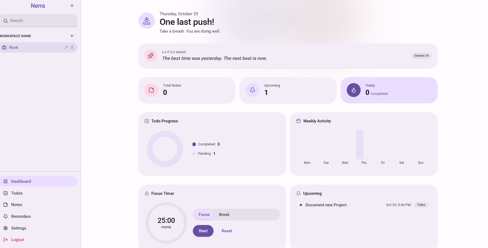
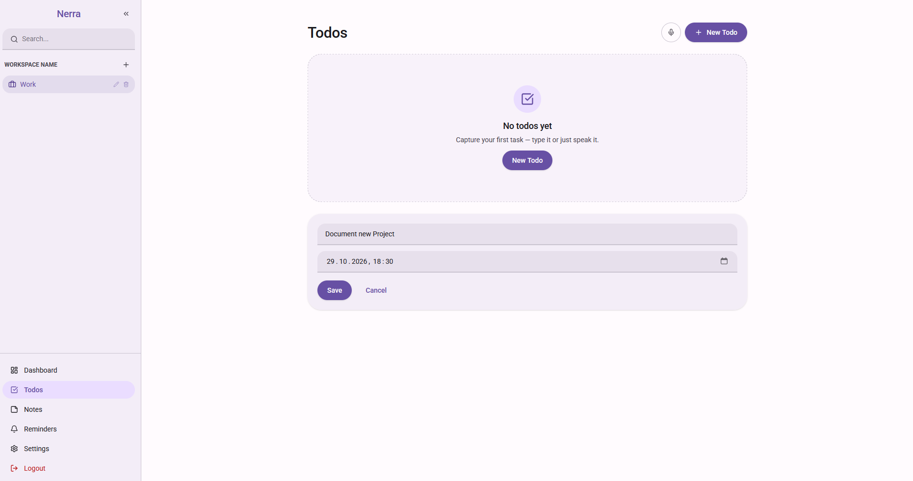
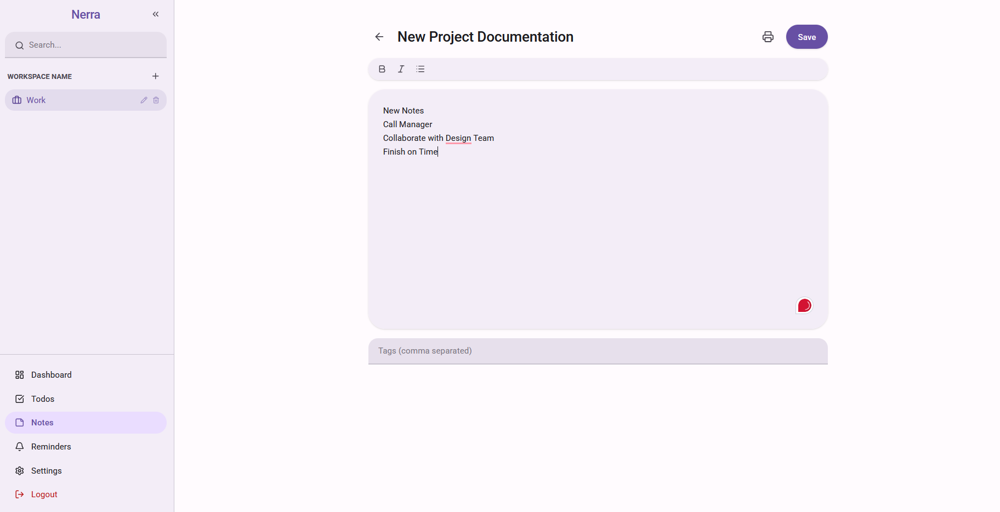
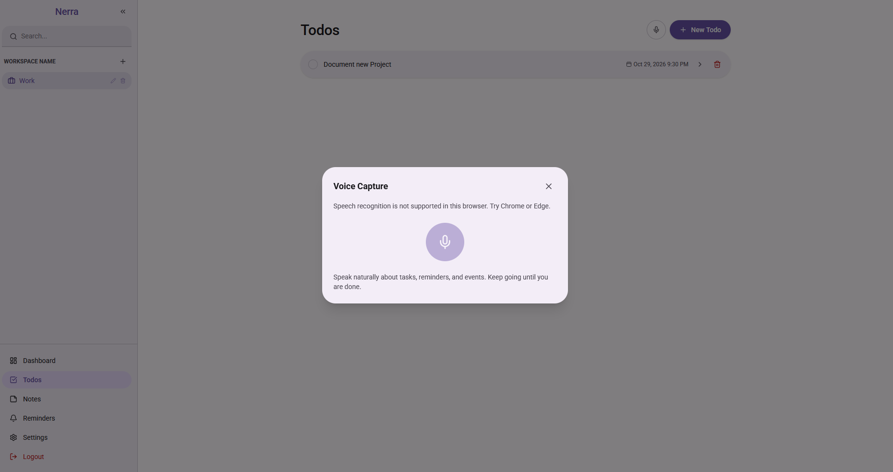

# Nerra

<div align="center">
  <strong>A calmer space for everything you need to get done.</strong>
  <br />
  Tasks, notes, and reminders in one thoughtful, bilingual workspace.
</div>

Nerra is a personal productivity app for organizing tasks, notes, and reminders in workspaces. It includes a dashboard, browser notifications, focus tools, and optional voice capture that turns spoken ideas into editable tasks and reminders. The interface supports English and Arabic, including right-to-left layouts, and light and dark themes.

## Screenshots

<div align="center">
  
  <br />
  <em>Your day at a glance: progress, focus time, and what is coming up.</em>
</div>

<table>
  <tr>
    <td align="center" width="50%">
      
      <br />
      <em>Capture tasks and due dates in your workspace.</em>
    </td>
    <td align="center" width="50%">
      
      <br />
      <em>Write and organize notes with simple formatting.</em>
    </td>
  </tr>
  <tr>
    <td align="center" colspan="2">
      
      <br />
      <em>Capture ideas by voice with browser speech recognition (Chrome or Edge recommended).</em>
    </td>
  </tr>
</table>

## How it works

The React frontend communicates with a Django REST API. Users authenticate with JWTs; the frontend attaches access tokens to API requests and refreshes them when needed. The API stores users' workspaces, todos and checklist items, notes, and reminders in a relational database. Development uses SQLite, while the backend can be configured for PostgreSQL.

Voice capture uses the browser's Web Speech API to transcribe speech. When a Groq API key is configured on the backend, the transcript can be sent to a language model to extract proposed tasks and reminders for review before saving.

## Technologies

- **Frontend:** React 19, TypeScript, Vite, Tailwind CSS 4
- **Frontend data and state:** TanStack Query, Zustand, Axios
- **Backend:** Python, Django 6.1, Django REST Framework, Simple JWT
- **Database:** SQLite for development; PostgreSQL configuration for deployment
- **Voice extraction:** Web Speech API and optional Groq API integration
- **Quality and security:** Django tests, Oxlint, and a GitHub Actions Gitleaks scan

## Run locally

Use a Python version supported by Django 6.1 and a current Node.js LTS release.

### Backend

From the repository root, create and activate a virtual environment, then install the backend dependencies:

```powershell
cd backend
py -m venv .venv
.\.venv\Scripts\Activate.ps1
python -m pip install -r requirements.txt
Copy-Item .env.example .env
```

For local development, no Groq key or custom Django secret is required. The development settings have a local-only fallback key. If you want to set your own key, generate one with:

```powershell
python -c "from django.core.management.utils import get_random_secret_key; print(get_random_secret_key())"
```

Add the generated value as `DJANGO_SECRET_KEY` in `backend/.env`. `GROQ_API_KEY` is optional and only needed for LLM-powered voice extraction. Keep `.env` local; never commit real credentials. Production deployments must always set a strong, unique `DJANGO_SECRET_KEY`.

Start the API:

```powershell
python manage.py migrate
python manage.py runserver
```

The API is available at `http://127.0.0.1:8000`.

### Frontend

In a second terminal from the repository root:

```powershell
cd frontend
npm ci
npm run dev
```

Open the local URL printed by Vite. Its development server proxies `/api` requests to the backend at `http://127.0.0.1:8000`.

## Tests and checks

Run backend tests from `backend/`:

```powershell
python manage.py test
```

Run frontend checks from `frontend/`:

```powershell
npm run lint
npm run build
```

## Repository layout

- `backend/apps/` — Django API apps, migrations, and tests
- `backend/config/` — Django settings and URL configuration
- `backend/core/` — shared API utilities
- `frontend/src/` — React application
- `.github/workflows/` — GitHub Actions secret scanning
